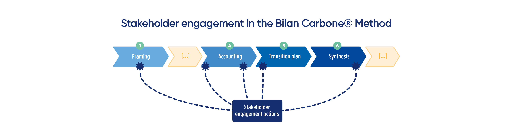

# 3 - Introduction to Stakeholder Engagement

<figure><figcaption>
Source: Freepik
</figcaption></figure>

The Bilan Carbone® vision is not solely focused on carbon accounting and the definition of a transition plan. It is an approach in which the stakeholder engagement phases are fundamental and ambitious. In order to facilitate the shift to action, the Bilan Carbone® approach requires **stakeholder engagement** around the Bilan Carbone® project and the transition plan that will be rolled out.

Engagement **continues uninterrupted** throughout the entire Bilan Carbone® approach. The timing of each engagement phase is provided here as a **guide**: what matters is that the right messages are delivered to the right audiences.

To achieve engagement, the Bilan Carbone® approach involves several **phases**: **popularising** the issues to raise awareness, **empowering** stakeholders, **co-constructing** actions, then **reporting** and communicating the results. These different engagement phases must be **adapted** to the various [maturity levels](../1-cadrage-de-la-demarche/1.1-definir-son-niveau-de-maturite-bilan-carbone-r.md)**, steps, stakeholders and organisation profiles:**

* Step [3.1.1](3.1-programmer-les-phases-de-mobilisation/3.1.1-au-lancement-et-cadrage-du-bilan-carbone-r.md): At the launch and framework of the Bilan Carbone®
* Step [3.1.2](3.1-programmer-les-phases-de-mobilisation/3.1.2-au-lancement-de-la-collecte-des-donnees.md): At the launch of data collection
* Step [3.1.3](3.1-programmer-les-phases-de-mobilisation/3.1.3-a-lissue-de-la-construction-du-profil-ges.md): Upon completion of the GHG emission profile
* Step [3.1.4](3.1-programmer-les-phases-de-mobilisation/3.1.4-pour-la-construction-du-plan-de-transition.md): For the construction of the transition plan
* Step [3.1.5](3.1-programmer-les-phases-de-mobilisation/3.1.5-en-synthese-de-la-demarche.md): In summary of the approach

<figure><figcaption>
Figure 3: Timeline of stakeholder engagement actions
</figcaption></figure>

## Glossary relating to the Engagement steps

All terms relating to the engagement steps are explained in the [glossary](../annexes/glossaire.md). They are recalled below:

* **Engagement action**: this is the combination of an engagement phase (awareness, empowerment, co-construction, or reporting), at a given step, targeting one or more audiences, with a more or less specific adaptation of messages according to the organisational profile.

**Presentation of the different stakeholder engagement phases:**

*   **Awareness and popularisation** :brain: : The main challenge of raising awareness and popularising the issues is to _understand in order to act_: strengthening the understanding of essential information around energy and climate issues, and building support around the approach to ensure better integration of the [transition plan](https://app.gitbook.com/s/GBSULMB7RDjF3KmSrnc9/5-plan-de-transition).

    _Objective_: Create the necessary foundation for a good understanding of the issues, acceptance of change and future actions to be undertaken, and enable the organisation to identify the risks and opportunities associated with ecological transition.

_Indicator_: Level of knowledge and understanding of the issues.
*   **Empowerment** :person\_raising\_hand:**:** The main challenge of empowerment is to give everyone a role in the approach. Stakeholders must become aware that every degree counts, that every action counts and therefore that every employee counts in implementing these actions. The organisation must become aware that what is at stake is its long-term viability. New responsibilities will emerge from the approach and will enhance existing positions by taking into account an essential component linked to the sustainability of the activity.

    _Objective_: Involve and empower each stakeholder to get moving and take action.

_Indicator_: Level of participation in the approach and level of transition to action.
*   **Co-construction** :thought\_balloon:**:** The main challenge of co-construction is to promote initiatives, sharing and consultation. Co-construction is central, and is therefore closely linked to the other types of stakeholder engagement: the stakeholders consulted must have a sufficient level of information about the approach, which requires effective :brain:awareness and popularisation beforehand, as well as transparent :loudspeaker: reporting and communication. Co-construction gives a voice and encourages participation, which makes it possible to :person\_raising\_hand:empower. It makes it possible to identify the carbon reduction areas that the organisation and its stakeholders can consider, drawing on their knowledge (of the process, the product, the organisation).

    _Objective_: Test the choice of actions against real possibilities and possible alternatives, to arrive at a transition plan perceived as a shared project between the organisation and its stakeholders.

_Indicator_: Level of participation in the co-construction of the transition plan.
*   **Reporting and communication** :loudspeaker: **:** The main challenge of reporting and communication is to enable the different stakeholders concerned to take ownership of the results and actions. Make the link between global issues, local issues, the organisation's impacts, the role of stakeholders in these impacts, the actions arising from them, and the role of stakeholders in the success of these actions.

    _Objective_: Make this approach an initiative that goes beyond the project team sphere to reach other relevant stakeholders (primarily internal employees) involved in the implementation of actions, in a logic of cross-functionality, integration, reputation and exemplarity.

    _Indicator_: Level of knowledge and understanding of results (impacts and actions)

**Overview of the different adaptations:**

* **Steps of the approach** :calendar\_spiral: **:** Stakeholder engagement **continues throughout** the entire Bilan Carbone® approach and adapts to the different steps:
  * At launch and framework ([step 1](https://app.gitbook.com/s/GBSULMB7RDjF3KmSrnc9/1-cadrage-de-la-demarche)): [awareness and popularisation](3-introduction-a-la-mobilisation.md#glossaire-relatif-aux-etapes-de-mobilisation)
  * For the identification of emission sources and data to be collected ([step 2](https://app.gitbook.com/s/GBSULMB7RDjF3KmSrnc9/2-perimetre-de-la-demarche)): [empowerment](3-introduction-a-la-mobilisation.md#glossaire-relatif-aux-etapes-de-mobilisation) of the holders of information & data
  * For the accounting of emissions ([step 4](https://app.gitbook.com/s/GBSULMB7RDjF3KmSrnc9/4-comptabilisation)): intermediate [reporting](3-introduction-a-la-mobilisation.md#glossaire-relatif-aux-etapes-de-mobilisation)
  * For the discussions around the transition plan ([step 5](https://app.gitbook.com/s/GBSULMB7RDjF3KmSrnc9/5-plan-de-transition)): [co-construction](3-introduction-a-la-mobilisation.md#glossaire-relatif-aux-etapes-de-mobilisation) of the actions
  * For the finalisation of the approach ([step 6](https://app.gitbook.com/s/GBSULMB7RDjF3KmSrnc9/6-synthese-et-restitution)): [empowerment](3-introduction-a-la-mobilisation.md#glossaire-relatif-aux-etapes-de-mobilisation), [reporting and communication](3-introduction-a-la-mobilisation.md#glossaire-relatif-aux-etapes-de-mobilisation)
* **Targets and stakeholders** :busts\_in\_silhouette:**:** The stakeholders revolving around the organisation can be divided as follows. They will be called upon during distinct phases of the stakeholder engagement.
  * Project team, internal leads
  * Management
  * Other internal collaborators (employees, staff, volunteers)
  * Upstream external stakeholders (suppliers)
  * Downstream external stakeholders (customers)
  * Other external stakeholders (financial and technical partners, local actors, professional federations, or other partners on subjects that are strategic for the organisation such as education, innovation, development).
*   **Organisation profile** :bar\_chart: **:** The different organisation profiles must be taken into account in order to adapt the messages conveyed. They can be divided by sector & occupation, or at the very least between:

    * Profile or sector "lower emitter or decarbonising"
    * Profile or sector "very high emitter"
    * Profile or sector "at risk"

    This classification remains subjective, but it can be based on the [reference framework](../annexes/annexes/annexe-9-ressources-pour-la-mobilisation/classification-des-profils-dorganisations.md) proposed in the appendix. Being part of a **lower emitter** sector does not mean that the organisation is actually a low emitter. This classification must be analysed in light of the organisation's actual activity. For Initial and Standard maturity levels, messages are generally universal. The adaptation of the message becomes increasingly specific and ambitious as the organisation gains in maturity. A specific focus is necessary from the Advanced level onwards, as presented in the following sections and in the [appendix](../annexes/annexes/annexe-9-ressources-pour-la-mobilisation/classification-des-profils-dorganisations.md).

## Governance relating to the Engagement steps

The governance of the Engagement step is part of the [overall governance](../1-cadrage-de-la-demarche/1.2-definir-le-pilotage-de-la-demarche-bilan-carbone-r.md) of the Bilan Carbone® approach presented previously. It is the Coordinator who steers the different engagement phases.

Facilitators or speakers can be external or internal depending on the skills sought. To scale up the engagement phases, it is advisable to train a team of internal facilitators. The involvement of certain teams or departments will be essential to the proper conduct of the engagement steps, in particular management and communications.

## Requirements relating to the Engagement steps

As a **reminder**, here is the [summary of requirements](../1-cadrage-de-la-demarche/1.1-definir-son-niveau-de-maturite-bilan-carbone-r.md#comparatif-des-criteres-des-niveaux-de-maturite-pour-lamelioration-continue-du-bilan-carbone-r) and recommendations, for each maturity level. Engagement content must take into account the organisation's maturity level. They are explained in detail in the following sub-sections.



#### Engagement:

* H: Stakeholder engagement targets
  * H1: Stakeholder engagement targets at least the organisation's internal stakeholders, i.e. the project team, employees and management.
* I: Stakeholder engagement messages
  * I1: The following stakeholder engagement phases: awareness and popularisation, empowerment, reporting and communication, occur at least once during the approach.
* J: Stakeholder engagement steps
  * J1: At least one stakeholder engagement action occurs during the approach's launch, intermediate reporting and approach summary steps.



#### Stakeholder engagement

* H: Stakeholder engagement targets
  * H2: Stakeholder engagement targets internal stakeholders (project team, employees and management). It is extended to at least one of the external stakeholders (customers or suppliers), depending on their impact in the Bilan Carbone®.
* I: Stakeholder engagement messages
  * I2: Each stakeholder engagement phase (awareness and popularisation, empowerment, co-construction, reporting and communication) occurs at least once in the approach, with adaptation work according to the steps and targets.
* J: Stakeholder engagement steps
  * J2: At least one stakeholder engagement action occurs at each step of the Bilan Carbone® approach: launch of the approach, launch of data collection, interim reporting, construction of the transition plan and summary of the approach.



#### Stakeholder engagement:

* H: Stakeholder engagement targets
  * H3: Stakeholder engagement targets internal stakeholders (project team, employees and management). It also targets at least one upstream external stakeholder (suppliers) and at least one downstream external stakeholder (customers), according to their impact in the Bilan Carbone®.
* I: Stakeholder engagement messages
  * I3: Each stakeholder engagement phase (awareness and popularisation, empowerment, co-construction, reporting and communication) occurs at least once in the approach, with adaptation work according to the stages, the targets, and the organisation's profile.
* J: Stakeholder engagement stages
  * J3: At least one stakeholder engagement action takes place at each stage of the Bilan Carbone® approach: launch of the approach, launch of data collection, intermediate reporting, construction of the transition plan and summary of the approach.



## Deliverables relating to the Engagement steps

The information and deliverables obtained at the end of step 3, and associated with the requirements above, must be [reported](../6-synthese-et-restitution/6.1-restitution-du-bilan-carbone-r.md) at the end of the approach:

* [x] A summary of the different engagement phases that were implemented: their targets, the messages delivered, their format, the associated step of the approach.

For example: one row per stakeholder engagement action. Additional information is useful (format, date, participation, etc.):

<table data-full-width="true"><thead><tr><th width="215">Stakeholder engagement action</th><th width="231">Targets<select multiple><option value="BFrVMg3du4Zx" label="Project team" color="blue"></option><option value="nK9xaJXmdru8" label="Management" color="blue"></option><option value="Qo1i6cKqXeae" label="Other internal employees" color="blue"></option><option value="kPIrVsp4HEV1" label="Upstream external stakeholders" color="blue"></option><option value="9iVJigfqS5Jp" label="Downstream external stakeholders" color="blue"></option><option value="I3feAVYmdmky" label="Other external stakeholders" color="blue"></option></select></th><th width="265">Steps<select><option value="pIOMiNp31Zf6" label="At the launch and framework of the Bilan Carbone®" color="blue"></option><option value="NeYJHfFhUtG4" label="At the launch of data collection" color="blue"></option><option value="BbmKfsx4yMAz" label="For building the GHG profile" color="blue"></option><option value="3oRPIg4yAB1B" label="For building the transition plan" color="blue"></option><option value="cAkIQHezo1sw" label="As a summary of the approach" color="blue"></option></select></th><th>Stakeholder engagement phase<select><option value="zIWzZ5K5POeL" label="Reporting and Communication" color="blue"></option><option value="tXHZ8k1sbnGl" label="Awareness and popularisation" color="blue"></option><option value="IOBgCGSTvD7D" label="Co-construction" color="blue"></option><option value="GJHNB7pSWFzK" label="Empowerment" color="blue"></option></select></th></tr></thead><tbody><tr><td>
Action no. 1.

Date - Format - Participation
</td><td>Project team, Management, Other internal employees, Upstream external stakeholders</td><td>As a summary of the approach</td><td>Reporting and Communication</td></tr><tr><td>Action no. 2 Date - Format - Participation</td><td>Management</td><td>For building the transition plan</td><td>Awareness and popularisation</td></tr><tr><td>[…]</td><td>Other internal employees</td><td>At the launch of data collection</td><td>Empowerment</td></tr></tbody></table>

***

_Do you have a question? [Consult the FAQ](../annexes/faq.md). The method is a living document and may therefore evolve (clarifications, additions): find the [change history here](../avant-propos/historique-et-suivi-des-modifications.md)._
