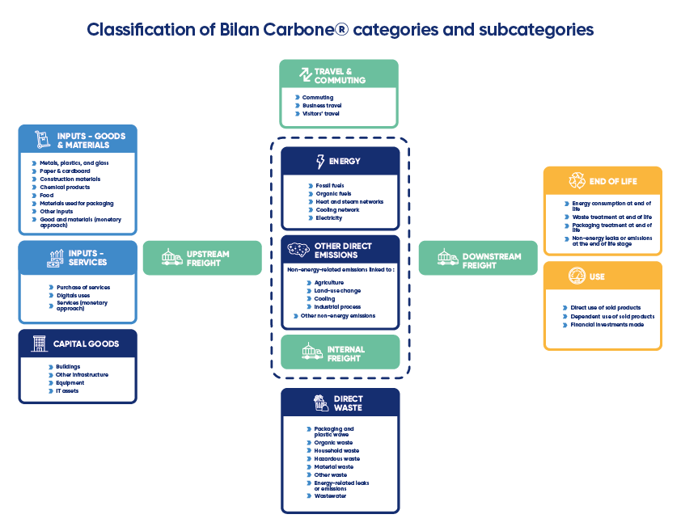
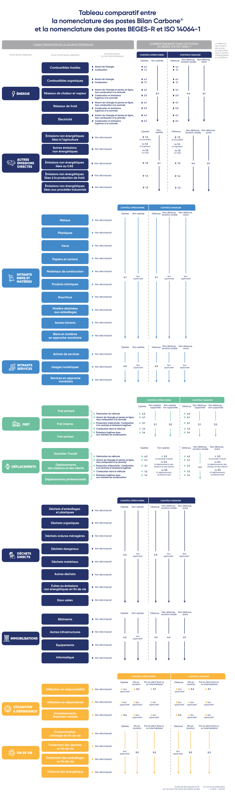
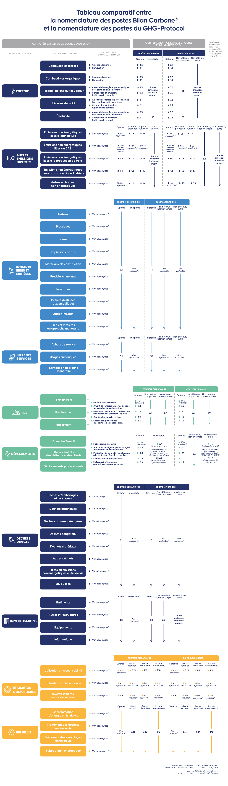

# 4.5 - Emission Profile

<figure><figcaption>
Source: Freepik
</figcaption></figure>


As a reminder, the emissions of each emission source of the organisation are estimated as follows:

Emission from a source = [Activity data](4.2-methode-de-collecte-des-donnees-dactivite.md) x [Emission factor](4.3-methode-de-selection-des-facteurs-demission.md) = [Result](4.5-profil-demission.md) ± [Uncertainty](4.4-methode-destimation-des-incertitudes/)


This subsection deals only with the GHG emissions profile, i.e. the aggregation and presentation of the results for all emission sources included within the previously defined boundaries, obtained at the end of the accounting step, and which feed into the [intermediate reporting](4-introduction-a-la-comptabilisation-des-emissions.md#mobilisation-relative-aux-etapes-de-comptabilisation).

The [final reporting stage](https://app.gitbook.com/s/GBSULMB7RDjF3KmSrnc9/6-synthese-et-restitution) presents the remaining deliverables expected at the end of the approach.

## GHG emissions profile in the Bilan Carbone® format

Emissions from all of the organisation's activities must be allocated across the 10 emission categories and 48 emission subcategories of the Bilan Carbone®. These categories reflect the organisation's main flows and provide a clear view of the areas where action should be taken as a priority.

Each emission must be accounted for in only one subcategory (and therefore in only one category). For each subcategory, the emissions profile must clearly show:

* The associated emissions, in tCO2e or kgCO2e
* The associated uncertainties, in the required [reporting format](4.4-methode-destimation-des-incertitudes/4.4.2-comment-les-determiner.md#formats-de-restitution)
* The share of emissions accounted for using spend-based emission factors (specific and non-specific), as a percentage. The organisation may choose to distinguish between a share based on specific spend-based emission factors and a share based on non-specific spend-based emission factors

This emission profile must be [presented](../3-mobilisation-des-parties-prenantes/3.1-programmer-les-phases-de-mobilisation/3.1.3-a-lissue-de-la-construction-du-profil-ges.md) to the appropriate stakeholders.

The Bilan Carbone® emission subcategories are structured as follows:

<figure><figcaption>
Figure 4.5.1: Nomenclature of Bilan Carbone® emission categories and subcategories.
</figcaption></figure>

The definitions of emission categories, the emission sources they include and the associated general accounting principles are detailed in the [Annex](../annexes/annexes/annexe-1-grands-principes-de-comptabilisation-du-bilan-carbone-r.md).


It is recommended to present the final emission profile **with and without** the "Use in dependency" subcategory. The 2 results are complementary and the Bilan Carbone® must be able to provide indicators suited to each lever of action.

These two subcategories lead to different analyses and therefore different [actions](../5-plan-de-transition/5.2-construction-du-plan-daction.md) within the transition plan. The "Use in responsibility" subcategory will generally lead towards actions improving the energy efficiency of products (during their use phase), reducing product weight, or reducing the consumption of materials induced by the use of the product or service. Conversely, the "Use in dependency" subcategory targets more [strategic](../5-plan-de-transition/5.2-construction-du-plan-daction.md#les-differentes-categories-dactions) [actions](../5-plan-de-transition/5.2-construction-du-plan-daction.md#les-differentes-categories-dactions): resilience of the business model, or actions carried out in cooperation with the downstream value chain to reduce emissions in this category.



It is recommended to customise the organisation's GHG emissions profile, in order to facilitate as much as possible a good understanding of the results and the subsequent development of the transition plan. This customisation may, for example, include the following actions:

* Rename a category or subcategory to align it with the internal reality of the organisation. For example, the subcategory "Outbound freight" could be renamed "Product distribution".
* Merge certain categories or subcategories together
* Separate certain categories or subcategories into several distinct categories or subcategories

The organisation must briefly justify its choices if these involve a variation from the format presented above.

:mag\_right: _The personalisation of the emission profile can be based on an "_ [_analytical_](4.5-profil-demission.md#comptabilite-carbone-analytique) _" reading._


To properly analyse the results of this accounting step and thus prepare the development of the transition plan, it is recommended that the organisation also enrich its emission profile:

* By producing charts or visuals highlighting the various results obtained and the points deserving particular attention
* By producing charts or visuals popularising the results, for example by comparing the orders of magnitude of the emissions obtained with reference activities (for example the combustion of a litre of oil, a plane journey)
* By detailing the breakdown of emissions within each of the assessment's categories, and by analysing these results in more or less detail for each category, depending on the importance of that category within the Bilan Carbone®. The three most significant categories of the assessment must be the subject of a detailed analysis
* By establishing additional indicators derived from the results obtained. Some classic examples include:
  * A carbon intensity per €k of turnover, in tCO2e/€k or kgCO2e/€k
  * A carbon intensity per full-time equivalent (FTE), in tCO2e/FTE or kgCO2e/FTE
  * A carbon intensity per unit of output, in tCO2e/unit or kgCO2e/unit
* By linking emissions to the activity data or emission factors involved, where relevant


For a Standard or Advanced level, it is recommended to report the activity data and associated emissions on the [flow mapping](../2-perimetre-de-la-demarche/2.4-perimetre-operationnel.md#exigences-relatives-a-la-cartographie-des-sources-demissions), in order to obtain a [quantified flow mapping](../2-perimetre-de-la-demarche/2.4-perimetre-operationnel.md#optionnel-cartographie-quantifiee-des-flux).


## Other Emission Profile Formats

The organisation may present these results in the formats expected by other carbon accounting methods, using the correspondence tables below. All [Bilan Carbone® tools](../formation-et-outils-dapplication-de-la-methode/outils-bilan-carbone-r-tableurs-et-logiciel.md) allow results to be exported in these formats. For these exports to work, the organisation must characterise each emission source within these tools. This [characterisation](../annexes/glossaire.md#c) depends on the type of control approach chosen by the organisation. For further details, the organisation should refer to the relevant methodologies.\
\
It is recommended to export all GHGs accounted for in the Bilan Carbone®, even those relating to categories that are optional in certain standards.

### BEGES-R

If the organisation wishes to present these results in GHG Protocol format, it must publish its emissions in tCO2e, including the following GHGs: CO₂, CH₄, N₂O, NF₃, SF₆, [HFCs](../annexes/glossaire.md#hydrofluorocarbures), [PFCs](../annexes/glossaire.md#perfluorocarbures), CO₂b. These emissions must be broken down by type of GHG.

It can use the following correspondence table to obtain its GHG emissions profile in BEGES-R format:

<figure><figcaption>
Figure 4.5.2: Comparative table between Bilan Carbone® emission category nomenclature and BEGES-R and ISO 14064-1 category nomenclature.
</figcaption></figure>

### CSRD (ESRS E1-6 and E1-5)

For an export aimed at meeting CSRD requirements (ESRS E1-6), the organisation may use either the [GHG Protocol](4.5-profil-demission.md#ghg-protocol) format or the [ISO 14064-1](4.5-profil-demission.md#iso-14064-1) format. It must however also take NF₃ into account.

For a CSRD export, the organisation must also provide certain activity data in order to meet the requirements of ESRS E1 (E1-5). The table below indicates the activity data from the Bilan Carbone® that can be used to meet these requirements.

> ⏳\[[WIP](../#structures-des-informations-specifiques)] A future resource will be produced and made available to provide a correspondence table between Bilan Carbone® activity data and ESRS E1-5. These correspondences will be integrated into the Bilan Carbone® tool exports.

### GHG Protocol

If the organisation wishes to present these results in the GHG Protocol format, it must report its emissions in tCO2e, including the following GHGs: CO₂, CH₄, N₂O, [HFCs](../annexes/glossaire.md#hydrofluorocarbures), [PFCs](../annexes/glossaire.md#perfluorocarbures), SF₆. Accounting for CO₂b and the other gases is optional. These emissions must be broken down by type of GHG.

It can use the following correspondence table to obtain its GHG emissions profile in the GHG Protocol format:

<figure><figcaption>
Figure 4.5.4: Comparative table between Bilan Carbone® emission category nomenclature and the GHG Protocol.
</figcaption></figure>

### ISO 14064-1

If the organisation wishes to present these results in the ISO 14064-1 format, it must report:

* Emissions in tCO2e, including the following GHGs: CO₂, CH₄, N₂O, NF₃, SF₆, other relevant gases ([HFCs](../annexes/glossaire.md#hydrofluorocarbures), [PFCs](../annexes/glossaire.md#perfluorocarbures)) and CO₂b. These emissions must be broken down by GHG type for direct GHG emissions.
* GHG removals, in tCO2e

The organisation can use the correspondence table between Bilan Carbone® categories and BEGES-R and ISO 14064-1 categories ([located further up this page](4.5-profil-demission.md#beges-r)) to obtain its emission profile in ISO 14064-1 format.

### Analytical Carbon Accounting

If the organisation uses analytical accounting, emissions will be distributed according to the accounting codes and [analytical axes](../annexes/glossaire.md), established specifically for the organisation, which best reflect its structure and mode of operation (activities carried out, internal processes, etc.). Different analytical axes can be used for each emission category (for example purchases can be distributed by supplier, and energy by site).

Consequently, a generic correspondence table cannot be envisaged.

However, the organisation will find below a correspondence table listing all the accounting codes that will need to be reviewed in order to identify the emission sources that must be considered within the Bilan Carbone®. When an emission source does not give rise to monetary expenditure (unsupported emissions), it obviously remains to be taken into account within the Bilan Carbone®.

The table below presents the correspondence with the nomenclature of an accounting plan.

<figure><figcaption>
Figure 4.5.3: Comparative table between Bilan Carbone® emission category nomenclature and the nomenclature of accounting and analytical codes.
</figcaption></figure>

> ⏳\[[WIP](../#structures-des-informations-specifiques)] These correspondences will be integrated into the Bilan Carbone® tool exports.

## Requirements relating to the production of the emission profile

Here are the requirements to be met, which are similar for all 3 [maturity levels](../1-cadrage-de-la-demarche/1.1-definir-son-niveau-de-maturite-bilan-carbone-r.md):

Initial, Standard or Advanced Level: criteria N1, N2, and N3

For these three maturity levels, the emission profile must be presented in Bilan Carbone® format. Any choice made by the organisation that would involve a variation from this format must be briefly justified.

---

_Do you have a comprehension question?_ [_Consult the FAQ_](../annexes/faq.md)_. The method is living and therefore subject to change (clarifications, additions): find the_ [_change log here_](../avant-propos/historique-et-suivi-des-modifications.md)_._
