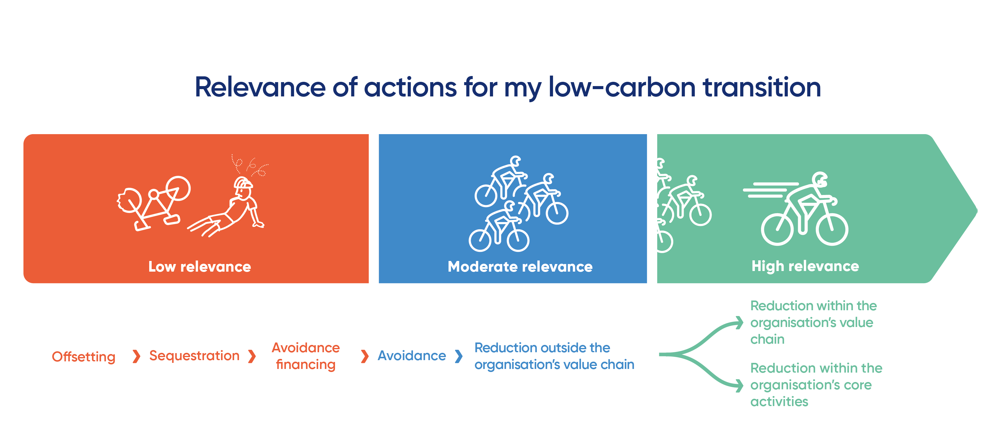

# 5.2 - Construction of the Action Plan

The action plan is the operational roadmap of the transition plan. It brings together all the specific actions and measures that the organisation will undertake following its carbon accounting exercise. They must be consistent with the [overall objective](5.1-definition-des-objectifs.md) that the organisation decides to adopt. To ensure they are achievable and understandable, their definition is framed as follows:

## The Different Categories of Actions

Actions can be classified in one or two of the following categories:

* _**Immediate actions**_: short-term actions that make it possible to launch the transition plan and motivate teams. These actions can be implemented without major difficulties and within a short timeframe;
* _**Priority actions**_: short- and medium-term actions that make it possible to strongly reduce emissions, since they directly concern significant categories;
* **Strategic actions**: medium- and long-term actions concerning the organisation's overall strategy and business model, which therefore make it possible to strongly reduce the organisation's carbon and economic vulnerability;
* _**Approach improvement actions**:_ actions that make it possible to step back and reflect on the Bilan Carbone® carried out. This may concern the evaluation of compliance with the principles of the Bilan Carbone®, improving data collection to gain in precision and reduce [uncertainties](../4-comptabilisation/4.4-methode-destimation-des-incertitudes/4.4.1-pourquoi-des-incertitudes.md), moving up in [maturity level](../1-cadrage-de-la-demarche/1.1-definir-son-niveau-de-maturite-bilan-carbone-r.md), and taking into account feedback regarding the [stakeholder engagement ](../3-mobilisation-des-parties-prenantes/3-introduction-a-la-mobilisation.md)carried out by the organisation;
* _**Adaptation actions**:_ short- and medium-term actions enabling adaptation to the consequences of climate change in order to ensure the resilience and survival of the organisation. They respond to the issues raised by the [identification of risks](../2-perimetre-de-la-demarche/2.5-identification-des-risques-et-opportunites-de-transition.md). These actions primarily concern the Standard and Advanced levels.

Every action must aim to **reduce** or **avoid** GHG emissions and/or vulnerabilities, and to mobilise where possible a potential for progress such as sequestration. Each action depends on the organisation's sector of activity. It will therefore be more [relevant](5.2-construction-du-plan-daction.md#pertinence-de-laction) and its impact greater, if it remains close to the organisation's core activity.

## Steps for Selecting Actions to Implement

Initially, a wide range of actions is studied. Subsequently, a [collective ](../3-mobilisation-des-parties-prenantes/3.1-programmer-les-phases-de-mobilisation/#etape-5-construction-du-plan-de-transition)decision will have to be made on the areas for reducing the organisation's footprint, which will guide the choice of the types of actions to implement. Moreover, the choice will often be guided by the balance between reducing the carbon footprint and other indicators (environmental, economic, social).

The steps to follow to choose actions are presented below.

> :mag\_right: _These steps are aligned with the_ [_ADEME Guide for the construction, implementation and monitoring of a transition plan_](../annexes/bibliographie/#guide-pour-la-construction-la-mise-en-oeuvre-et-le-suivi-dun-plan-de-transition-de-lademe)_:_

* Definition of the **reduction focus areas or directions**, which are the broad categories of the transition plan that will group together several actions on the same theme. These focus areas may correspond to the significant categories of the assessment. _(for example: working with suppliers, responsible purchasing, internal work,_ [_stakeholder engagement_](https://app.gitbook.com/s/GBSULMB7RDjF3KmSrnc9/3-mobilisation-des-parties-prenantes)_...)_ ;
* Identification of the **human**, **technical and financial resources** needed and/or available to make the transition plan achievable ;
* Definition of the **selection criteria** for the actions and their prioritisation _(for example: quantification of the action's impact, the budget required, the prerequisites for implementing the action...)_ ;
* **Evaluation** of the reduction actions against the defined criteria and selection of those with the best results. This must be done while ensuring the organisation's overall emissions reduction target is met, considering both the emission reductions generated by the action and the budget required to implement it ;
* Preparation of the **action sheets**. Their content is defined [below](5.2-construction-du-plan-daction.md#la-definition-des-fiches-actions) ;
* **Validation** of the reduction actions to be implemented and of their action sheets by the [transition plan leads](../1-cadrage-de-la-demarche/1.2-definir-le-pilotage-de-la-demarche-bilan-carbone-r.md).

When selecting actions, monitoring the actions implemented since the last assessment allows the relevant existing actions to be consolidated and continued.


Some sources of inspiration for selecting reduction actions

⏳\[[WIP](../#structures-des-informations-specifiques)] A future resource will be produced and made available publicly and transparently, grouping together several existing action banks.


## The Definition of Action Sheets

Each action is defined by an action sheet. These bring together the following information, which is mandatory (however additional information can be added):

1. Objectives and targets (sites and activities) of the action;
2. Emission reduction potentials, quantified;
3. Action owner(s);
4. Detailed description of the action and the involvement of stakeholders;
5. Budget and provisional schedule of the action;
6. Implementation, monitoring and [performance indicators](5.5-suivi-et-pilotage-du-plan-de-transition.md);
7. Facilitators and potential obstacles to the action;
8. Category(ies) of the action _(see_ [_here_](5.2-construction-du-plan-daction.md#categories-des-actions)_)_;
9. Nature of the action _(see_ [_here_](5.2-construction-du-plan-daction.md#nature-de-laction)_)_;
10. Relevance of the action _(see_ [_here_](5.2-construction-du-plan-daction.md#pertinence-de-laction)_) this only concerns mitigation actions._


Example of an action sheet: The example [action sheet](../annexes/annexes/annexe-10-ressource-pour-le-plan-de-transition.md#construire-une-fiche-action) below is provided for guidance only and consists of a mandatory core (information 1 to 10 above) to which additional information may be added:

* Title of the action; (free field)
* Its sub-steps; (free field)
* Detailed description of the action and involvement of stakeholders; (free field)
* Resources needed for its implementation; (free field)
* Additional information: (free field)


<figure><figcaption>
Figure 5.2: Example of a Bilan Carbone® <a href="https://www.bilancarbone-methode.com/annexes/annexes/annexe-10-ressource-pour-le-plan-de-transition#construire-une-fiche-action">action sheet</a>
</figcaption></figure>

### Characterising the nature of the action

In the interest of transparency of the transition plan, the actions it comprises can be classified according to their **nature:**

* Physical actions: modifications to equipment and systems;
* Organisational actions: changes in organisational processes;
* Behavioural actions: changes in daily behaviours;
* Regulatory actions: modification of rules.

> :mag\_right: _Classification compatible with the ADEME_ [_Quanti GES_](../annexes/bibliographie/#quanti-ges) _method._

### Characterising the relevance of the action

Mitigation actions (as distinct from adaptation or approach improvement actions) can also be classified by **relevance level**:

* **Maximum relevance** - Reduction actions in the core activity of the organisation: the organisation is entirely responsible for the action and its impacts;
* Reduction actions within the organisation's value chain: the organisation can control the impacts of the action that is part of its value chain;
* Reduction actions outside the organisation's value chain: the organisation is dependent and therefore cannot fully control the impacts of the action that is outside its value chain;
* **Relative relevance** - Avoidance actions: action through the effect of the products and services distributed or sold by the organisation, which substitute a more carbon-intensive solution for end customers, to avoid emissions or, failing that, reduce them;
* Avoidance financing actions: Actions financing emission reduction projects outside the organisation's value chain;
* Sequestration actions: action within the organisation's field of activity, aimed at reducing GHGs in the air through the increase of carbon sinks;
* **Minimum relevance -** Offsetting actions: when impacts could not be avoided, and through the financing of GHG sequestration projects outside the organisation's value chain.

It is important to prioritise more relevant actions, and for offsetting, sequestration and avoidance actions to remain in the minority.

<figure><figcaption>
Figure 5.2: Action relevance scale.
</figcaption></figure>

## Requirements relating to the Action Plan

Initial Level: criteria P1 and Q1

The transition plan contains immediate, priority and data collection improvement actions. Some strategic actions can perfectly well be included without it being a genuine roadmap.

The objectives of the actions are consistent with the overall objective of the transition plan, as they aim to achieve it. The overall emission reduction potential of the transition plan is evaluated quantitatively, and the reductions anticipated from the implementation of actions are evaluated qualitatively, at minimum with a simple classification system: low, medium, high, and by giving its degree of relevance according to the diagram above.

Standard Level: criteria P2 and Q2

The transition plan contains immediate, priority, strategic, adaptation and data collection improvement actions. Their objectives are consistent with the overall objective of the transition plan.

The emission reduction potentials anticipated from the implementation of actions are quantified, at minimum for immediate and priority actions. The quantification corresponds to the calculation of the differences between emissions in the baseline scenario and in the scenario where the action is implemented.

:mag\_right: _Different baseline scenarios are possible. (Source:_ [_Quanti GES_](../annexes/bibliographie/#quanti-ges) _method)._

The baseline scenario used for the quantification is specified:

* Historical scenario: continuation of the current state. No implementation of the action **and** emissions continue to evolve as they did before the action was implemented.
* Other scenarios: no implementation of the action and other factors have influenced the evolution of emissions _(these may be other actions, but also organisational, behavioural, climatic changes...)._

The emission reduction objective of actions, and the reduction potential this represents for the entire action plan, feeds the definition of the organisation's [transition pathway](5.3-definition-de-la-trajectoire-de-transition.md).

The effects of actions are evaluated **qualitatively**, particularly for actions that are not quantifiable. The [information requested in the action sheets](5.2-construction-du-plan-daction.md#la-definition-des-fiches-actions) allows the action to be qualified, and in particular its relevance.

Advanced Level: criteria P3 and Q3

The transition plan contains immediate, priority, strategic, adaptation and data collection improvement actions, significant and mutually consistent, also addressing certain avoided emissions.

The emission reduction potentials expected from implementing all immediate and priority actions are quantified. The reduction potentials of certain selected strategic actions are quantified where possible (the definition and quantification of strategic actions may build on pre-existing or complementary work, such as [ACT-S](../annexes/bibliographie/) or equivalent). Quantification corresponds to calculating the differences between the emissions of the baseline scenario and those of the scenario in which the action is implemented.

:mag\_right: _Different baseline scenarios are possible. (Source:_ [_Quanti GES_](../annexes/bibliographie/#quanti-ges) _method)._

The baseline scenario used for the quantification is specified:

* Historical scenario: continuation of the current state. No implementation of the action **and** emissions continue to evolve as they did before the action was implemented.
* Other scenarios: no implementation of the action and other factors have influenced the evolution of emissions _(these may be other actions, but also organisational, behavioural, climatic changes...)_

The emission reduction objective of each action, and the reduction potential this represents for the entire action plan, feeds the definition or updating of the organisation's [transition pathway](5.3-definition-de-la-trajectoire-de-transition.md).

The effects of actions are assessed qualitatively, particularly for actions that are not quantifiable. The information [requested in the action sheets](5.2-construction-du-plan-daction.md#la-definition-des-fiches-actions) makes it possible to qualify the action, and in particular its relevance. Other qualitative considerations are possible:

* **Contribution of the action** to risks and opportunities
* **Adequacy of the action** with the low-carbon world

> :mag\_right: _To express the Bilan Carbone® with a so-called “analytical” reading, in line with_ [_analytical carbon accounting_](../annexes/bibliographie/#guides-pratiques)_, each action includes, in addition to the information above, the relevant analytical axes._
>
> _If some actions can correspond to several analytical axes: they will be subdivided into several action sheets, identified on a single axis so as to have only one associated owner. For example, to act at site level, building one action sheet per site manager makes the action operational and involves only the managers of the sites concerned, while still allowing the aggregated actions to be steered across all sites._
>
> _This operational breakdown of the action for each owner (by internal analytical axis: team, activity, project, etc.); and by external stakeholders (by external analytical axis: suppliers, customers), makes it possible to put emissions and actions into perspective for each analytical axis, and therefore to_ [_monitor the results_](5.5-suivi-et-pilotage-du-plan-de-transition.md)_._
>
> _Regarding the “_[_approach improvement actions_](5.2-construction-du-plan-daction.md#les-differentes-categories-dactions)_”, specific actions relating to structuring analytical carbon accounting may be considered_

---

_Do you have a comprehension question?_ [_Consult the FAQ_](../annexes/faq.md)_. The method is living and therefore subject to change (clarifications, additions): find the_ [_change log here_](../avant-propos/historique-et-suivi-des-modifications.md)_._
