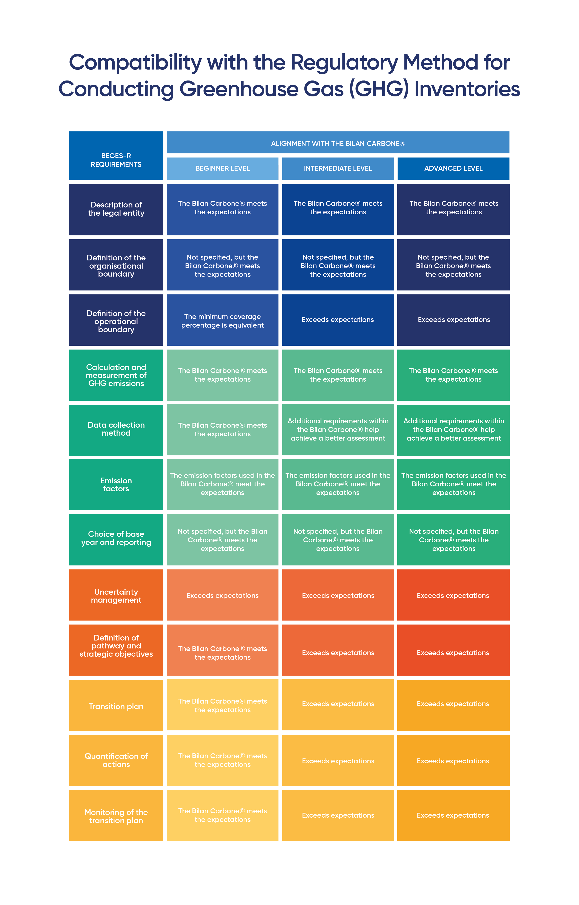
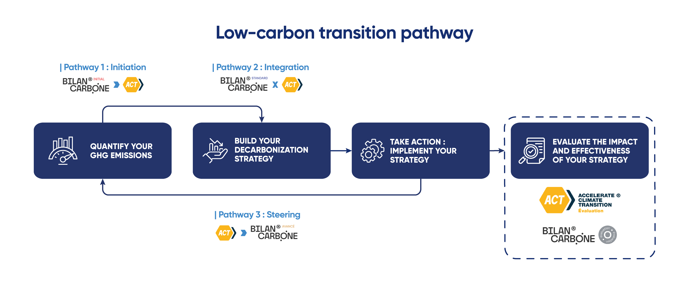
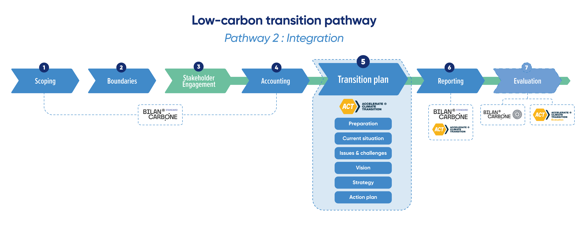

# 6.2 - Compatibility of the Approach with Other Frameworks

<figure><figcaption>
Source: Freepik
</figcaption></figure>

The Bilan Carbone® approach is compatible with many **methods and standards** and also allows various **norms and regulations** concerning carbon accounting and decarbonisation strategy to be addressed. Among these **frameworks** are:&#x20;

* [The regulatory method for carrying out GHG emission reports](../annexes/bibliographie/#methode-reglementaire) (BEGES-R)
* The [Corporate Sustainability Reporting Directive](../annexes/bibliographie/#csrd) (CSRD)
* [Analytical carbon accounting](../annexes/bibliographie/#guides-pratiques) (CCA)
* The [Green House Gas Protocol](../annexes/bibliographie/#ghg-p) (GHG-P)
* &#x20;[ISO 14064-1:2018 and ISO 14069:2013](../annexes/bibliographie/#iso) (ISO)

Various methods complementary to the Bilan Carbone® exist, enabling progression along the [maturity pathway](../introduction-a-la-transition-bas-carbone/quelle-integration-du-bilan-carbone-r-au-sein-dune-demarche-de-transition-bas-carbone.md#id-4-le-bilan-carbone-r-dans-une-demarche-de-transition-bas-carbone-section-a-relire-et-finir), such as the [ACT-Step by Step](../annexes/bibliographie/#act-pas-a-pas-ou-act-step-by-step) approach.

## Compatibility with the Regulatory GHG Report

By following the Bilan Carbone® method, an organisation meets the requirements of the regulatory method for carrying out GHG emission reports ([BEGES-R](../annexes/bibliographie/)), from the first [maturity level](../1-cadrage-de-la-demarche/1.1-definir-son-niveau-de-maturite-bilan-carbone-r.md) (Initial Level).

The table below illustrates the correspondence between the various requirements of the regulatory method and how the Bilan Carbone® addresses them.

<figure><figcaption>
Figure 6.2.1: Compatibility between Bilan Carbone® and the Regulatory GHG Report
</figcaption></figure>

Submission of the regulatory method is done via the [national platform](../annexes/bibliographie/#autres-standards-normes-et-reglementations-de-comptabilisation-des-emissions-de-ges) for the publication of greenhouse gas emission reports by ADEME.&#x20;

## Compatibility with Diag Décarbon'Action

The [Diag Décarbon'Action](https://www.bilancarbone-methode.com/annexes/bibliographie#autres-standards-normes-et-reglementations-de-comptabilisation-des-emissions-de-ges) is a support programme created and funded by Bpifrance and ADEME, with the methodological support of ABC, which enables a first greenhouse gas emission assessment to be carried out.

The Bilan Carbone® can be used to respond to the programme. In particular, by drawing on the criteria of the [Initial Level](../1-cadrage-de-la-demarche/1.1-definir-son-niveau-de-maturite-bilan-carbone-r.md), which are suited to the targets of the Diag Décarbon'action (VSEs, SMEs and certain mid-sized companies, i.e. beginner organisations or small structures with limited resources, carrying out their first Bilan Carbone®).&#x20;

A correspondence table below presents the details of the correspondences between an Initial-level Bilan Carbone® and a Diag Décarbon'Action:&#x20;

<figure><figcaption>
Figure 6.2.2: Compatibility between Bilan Carbone® and Diag Décarbon'action
</figcaption></figure>

It should be noted that in addition to this, the Diag Décarbon'action programme requires a "transition action" (non-exhaustive and non-cumulative examples: preparation of a communication plan, construction of a GHG calculator, action results monitoring system, etc.), which aligns with the Bilan Carbone® prescriptions on the [transition plan implementation](../5-plan-de-transition/5.4-mise-en-oeuvre-du-plan-de-transition.md) phase.&#x20;

## Compatibility with the Corporate Sustainability Reporting Directive

The European CSRD directive encourages organisations to transform their business models to address climate challenges and the scientific realities of the environmental and social impact of economic activities. The Bilan Carbone® approach, essential in this context, enables organisations to account for their greenhouse gas emissions and assess the impact of their activities. Drawing on this data, organisations can develop a structured transition plan to reduce their emissions and achieve CSRD objectives.

Following the Bilan Carbone® approach, from the [Advanced maturity level](../1-cadrage-de-la-demarche/1.1-definir-son-niveau-de-maturite-bilan-carbone-r.md), allows the majority of the requirements of ESRS E1 of the CSRD to be met, which concerns climate change. ESRS E1 is divided into 12 Disclosure Requirements (DRs): E1.GOV-3, E1.IRO-1, E1.SBM-3, E1-1, E1-2, E1-3, E1-4, E1-5, E1-6, E1-7, E1-8, and E1-9. Each DR contains a certain number of data points to be reported.

The Bilan Carbone® accounting stage and the export of the [emission profile](../4-comptabilisation/4.5-profil-demission.md#csrd-esrs-e1-6-et-e1-5) in the requested reporting format covers DRs E1-5 and E1-6. Other stages of the Bilan Carbone® approach (transition plan, risk analysis) allow coverage of the majority of the other DRs.

> <mark style="background-color:blue;">⏳\[</mark>[<mark style="background-color:blue;">WIP</mark>](../#structures-des-informations-specifiques)<mark style="background-color:blue;">] To date, an independent consultancy has conducted an evaluation of the compatibility rates between the two frameworks. They are presented below, in order to simplify the integration of these elements with CSRD requirements.</mark> <mark style="background-color:blue;"></mark><mark style="background-color:blue;">**Developments are planned in the method, and especially in the tools, to automate coverage of additional data points.**</mark>

**\*% DP covered:** A DP designated as "covered" below is not systematically a total correspondence. It refers to the rate of DPs for which the Bilan Carbone® provides information, but potentially partially: through developments in progress (methodological adjustments, future tools), or whose quality of response depends on the organisation itself.

<table data-full-width="true"><thead><tr><th width="180">DR</th><th width="81">% DP*</th><th width="405">Details</th><th>⏳[WIP] Planned developments</th></tr></thead><tbody><tr><td>E1-1: Develop a transition plan for climate change mitigation</td><td>63%</td><td>The Bilan Carbone® method is a good foundation and partially covers E1 on many aspects. Although developments are planned, the method does not aim to cover 100% of DPs. Further work is necessary. For example regarding the strategic approach, this is a prerequisite of the Advanced Level, which can be built between two assessment renewals, via ACT-S or equivalent.)</td><td>Minor developments to the method are planned to improve certain partially-covered DPs, which will not significantly increase the overall %. These are clarifications and reformulations (for example on strategic actions, on carbon indicators as KPIs, for which the Advanced Level already has operational requirements).</td></tr><tr><td>E1-2: Demonstrate that policies relating to climate change mitigation and adaptation are in place</td><td>100%</td><td>The Bilan Carbone® method covers all of E2, at least partially. Developments are planned to maximise the coverage of certain DPs. No further work required.</td><td>Minor developments to the method are planned to improve certain partially-covered DPs, aiming for maximum coverage. These are clarifications on certain concepts (energy efficiency, renewable energies and adaptation).</td></tr><tr><td>E1-3: Publish actions and resources related to climate policies</td><td>100%</td><td>The Bilan Carbone® method covers all of E3, at least partially. This DR being at the heart of the transition plan stages of the Bilan Carbone® method. Developments are planned to maximise the coverage of certain DPs. No further work required.</td><td>Minor developments to the method are planned to improve certain partially-covered DPs, aiming for maximum coverage. These are clarifications notably on the concepts of Capex and Opex enabling climate to be anchored at the heart of business strategy.</td></tr><tr><td>E1-4: Objectives related to climate change mitigation and adaptation</td><td>100%</td><td>The Bilan Carbone® method covers all of E4, at least partially. This DR being at the heart of the transition plan stages of the Bilan Carbone® method. Developments are planned to maximise the coverage of certain DPs. No further work required.</td><td>Minor developments to the method are planned to improve certain partially-covered DPs, aiming for maximum coverage. These are clarifications notably on a specific list of indicators, on separate objectives for scopes 1, 2 and 3, or on 1.5°C-aligned objectives.</td></tr><tr><td>E1-5: Energy consumption and energy mix</td><td>74%</td><td>The Bilan Carbone® method covers the majority of E5, at least partially. Several developments are planned for the method to cover 100% of DPs, this DR being at the heart of the emission quantification stage. No additional further work required.</td><td>The majority of developments concern the creation of a CSRD Export that will be added to future tools (January 2025), aiming for maximum coverage of this DR. This notably concerns a list of energy indicators. The completeness of this export will be optional, if the Bilan Carbone® is to be used for the CSRD reporting exercise.</td></tr><tr><td>E1-6: Gross GHG emissions from scopes 1, 2, 3 and total</td><td>71%</td><td>The Bilan Carbone® method covers the majority of E6, at least partially. Several developments are planned for the method to cover 100% of DPs, this DR being at the heart of the emission quantification stage. No additional further work required.</td><td>The majority of developments concern the creation of a CSRD Export that will be added to future tools (January 2025), aiming for maximum coverage of this DR. This notably concerns a list of indicators, the concept of dependency on high-impact sectors, and the specific emissions from scopes 1 and 2. The completeness of this export will be optional, if the Bilan Carbone® is to be used for the CSRD reporting exercise.</td></tr><tr><td>E1-7: GHG removals and GHG mitigation projects financed through carbon credits</td><td>0%</td><td>This DR is not covered by the Bilan Carbone® method, and is not intended to be. Additional further work is therefore necessary.</td><td>ABC and its community wishes to position itself on this topic, but potentially in addition to the current Bilan Carbone® method.</td></tr><tr><td>E1-8: Carbon pricing</td><td>0%</td><td>This DR is not covered by the Bilan Carbone® method, and is not intended to be. Additional further work is therefore necessary.</td><td>No developments planned.</td></tr><tr><td>E1-9: Anticipated financial effects of physical and transition risks and potential climate-related opportunities</td><td>100%</td><td>The Bilan Carbone® method partially covers all of E9. Although developments are planned, the method does not aim to cover these DPs other than partially. Additional further work is therefore necessary. For example regarding risk analysis, this is a prerequisite that can be built in a complementary manner at the Advanced Level (TCFD, OCARA or equivalent).</td><td>Minor developments to the method are planned to improve certain partial coverages, but it will continue to address most DPs only partially. These are clarifications notably on the risk analysis method.</td></tr><tr><td>E1.GOV-3: Integration of strategy into governance</td><td>0%</td><td>This DR is not covered by the Bilan Carbone® method, and is not intended to be. Additional further work is therefore necessary. The method strongly recommends the use of ACT-S if there is a need to deepen the missing fields of this DR.</td><td>No developments planned.</td></tr><tr><td>E1.SBM-3: Resilience of the business model to climate challenges</td><td>85%</td><td>The Bilan Carbone® method is a good foundation and partially covers DR SMB-3 on many aspects. Although developments are planned, the method does not aim to cover 100% of DPs. Further work is necessary. The method strongly recommends the use of ACT-S if there is a need to deepen the missing fields of this DR.</td><td>Minor developments to the method are planned to improve certain partial coverages, notably on the link between climate strategy and the organisation's overall strategy, or on adaptation objectives.</td></tr><tr><td>E1.IRO-1: Analysis of climate impacts, risks and opportunities</td><td>88%</td><td>The Bilan Carbone® method is a good foundation and partially covers IRO-1 on many aspects, notably on the notion of temporality (short, medium, long term) and scenarios. The method does not aim to cover 100% of DPs. Further work therefore remains necessary. The method strongly recommends the use of a complementary method (TCFD, OCARA or equivalent) if there is a need to deepen the missing fields of this DR.</td><td>No developments planned.</td></tr></tbody></table>

> <mark style="background-color:blue;">⏳\[</mark>[<mark style="background-color:blue;">WIP</mark>](../#structures-des-informations-specifiques)<mark style="background-color:blue;">] We are actively working to develop the</mark> [<mark style="background-color:blue;">tools</mark>](../formation-et-outils-dapplication-de-la-methode/outils-bilan-carbone-r-tableurs-et-logiciel.md) <mark style="background-color:blue;">so that they are fully optimised, with specific features for a CSRD export. For information, a more complete and updated table will be inserted here shortly to illustrate the correspondence between the various CSRD ESRS E1 directives (DRs) and how the Bilan Carbone® covers these data points.</mark>

The CSRD report must be published in a dedicated section within the management report and must be made publicly available in European single electronic format (ESEF), within the framework of the ESAP project (European Single Access Point).

## Compatibility and Link with ACT Step by Step

Following the Bilan Carbone® approach, organisations wishing to deepen and refine their decarbonisation strategy can embark on approaches such as [ACT-Step by Step](../annexes/bibliographie/#act-pas-a-pas-ou-act-step-by-step).

To ensure that following ACT goes as smoothly as possible, certain criteria of the Bilan Carbone® method must be carefully respected, as they are prerequisites for the ACT approach.

The Bilan Carbone® and ACT step-by-step are two complementary approaches with a common goal. ABC and ADEME, French Public Agency for Ecological Transition, recommend combining the Bilan Carbone® and ACT® through **3 possible pathways** depending on your maturity:

<figure><figcaption>
Figure 6.2.3: Low carbon transition pathway Bilan Carbone® x ACT step-by-step
</figcaption></figure>

### Pathway 1: Initiation&#x20;

**A Bilan Carbone® Initial level followed by ACT step-by-step**

* An initial emissions inventory and the definition of a short-term action plan, by carrying out a Bilan Carbone® Initial level.
* It can be followed by an ACT step-by-step approach to build an operational climate strategy ranging from the short to the long term, consistent with the organisation's overall strategy.
* Ideal for organisations just starting out.

> <mark style="background-color:blue;">⏳\[</mark>[<mark style="background-color:blue;">WIP</mark>](../#structures-des-informations-specifiques)<mark style="background-color:blue;">] For information, an infographic 6.2.4 will soon be inserted here to illustrate this pathway.</mark>&#x20;

The table below provides the details needed to properly articulate these two approaches:

| What the Initial Bilan Carbone® does                                                                                                                                                                                                                                                                                                                                                                                                                                                                                                                                                                                                                                                                                                                                                                                                                                                                                                                                                                                                                                                                                                                                                       | Comments                                                                                                                                                                                                                                                                                                                                                                                                                                                                                                                                                                                                                                                                                                                                                                                                                                                                                                                                                                                                                                                                                                                                                                                                                                                                                                                                                                                       | Overlap between the Initial Bilan Carbone® and ACT Step-by-Step                                                                                                                                                                                                                                                                                                                                                                                                                                                                                                                                                                                                                                                                                                                                                                                                                                                                                                                                                                                                                                                                                                                                                                                                                                                                                                                                                                                                                                                                                                                                                                                                                                                                             | What ACT Step-by-Step does                                                                                                                                                                                                                                                                                                                                                                                                                                                                                                                                                                                                                                                                                                        |
| -------------------------------------------------------------------------------------------------------------------------------------------------------------------------------------------------------------------------------------------------------------------------------------------------------------------------------------------------------------------------------------------------------------------------------------------------------------------------------------------------------------------------------------------------------------------------------------------------------------------------------------------------------------------------------------------------------------------------------------------------------------------------------------------------------------------------------------------------------------------------------------------------------------------------------------------------------------------------------------------------------------------------------------------------------------------------------------------------------------------------------------------------------------------------------------- | --------------------------------------------------------------------------------------------------------------------------------------------------------------------------------------------------------------------------------------------------------------------------------------------------------------------------------------------------------------------------------------------------------------------------------------------------------------------------------------------------------------------------------------------------------------------------------------------------------------------------------------------------------------------------------------------------------------------------------------------------------------------------------------------------------------------------------------------------------------------------------------------------------------------------------------------------------------------------------------------------------------------------------------------------------------------------------------------------------------------------------------------------------------------------------------------------------------------------------------------------------------------------------------------------------------------------------------------------------------------------------------------- | ------------------------------------------------------------------------------------------------------------------------------------------------------------------------------------------------------------------------------------------------------------------------------------------------------------------------------------------------------------------------------------------------------------------------------------------------------------------------------------------------------------------------------------------------------------------------------------------------------------------------------------------------------------------------------------------------------------------------------------------------------------------------------------------------------------------------------------------------------------------------------------------------------------------------------------------------------------------------------------------------------------------------------------------------------------------------------------------------------------------------------------------------------------------------------------------------------------------------------------------------------------------------------------------------------------------------------------------------------------------------------------------------------------------------------------------------------------------------------------------------------------------------------------------------------------------------------------------------------------------------------------------------------------------------------------------------------------------------------------------- | ------------------------------------------------------------------------------------------------------------------------------------------------------------------------------------------------------------------------------------------------------------------------------------------------------------------------------------------------------------------------------------------------------------------------------------------------------------------------------------------------------------------------------------------------------------------------------------------------------------------------------------------------------------------------------------------------------------------------------- |
| 
-G1: The organisation identifies the various risks related to climate change (physical risks, transition risks).  -O1: The organisation's vision is defined by a medium- and long-term objective (time horizons 2030 and 2050), expressed in absolute values, and consistent with the national strategy.  -P1: The transition plan contains immediate actions, priority actions and data collection improvement actions.  -Q1: An overall emission reduction potential of the transition plan is quantitatively assessed. The impacts of implementing the actions are qualitatively assessed.  -R1: The quantification of the reduction potential makes it possible to build a bottom-up pathway over 3-4 years, i.e. the period before the assessment is renewed. It justifies the achievement of a short-term objective (horizon of the next assessment) consistent with the overall objective.  -S1: Monitoring and action implementation indicators are defined. Monitoring of performance indicators (significant emissions) between each renewal of the approach is not mandatory.
 | 
The Initial level constitutes a first Bilan Carbone®, meeting in particular the requirements of the BEGES-R and of the Diag Décarbon'action.   A first identification of physical and transition risks is carried out: - the organisation lists the various risks and impacts related to climate change, without these necessarily being specific to it.  A first transition plan is produced, containing: - initial objectives, which do not need to be expressed in relative intensity, nor to be based on an in-depth sector analysis or on a detailed projection of the organisation's overall activity. - immediate actions, priority actions and data collection improvement actions. The action sheets contain information on their implementation and on their reduction potential (qualitative). - the overall reduction volume of the Transition Plan (quantitative), whose order of magnitude may be based on a quantification of the cumulative effects of the main actions (and not necessarily on a quantification of each action). - this volume makes it possible to draw a first reduction pathway over the next 3-4 years. - monitoring and implementation indicators associated with the actions, which are not necessarily covered by a monitoring system.
 | 
ADEME, French Public Agency for Ecological Transition, recommends using the Bilan Carbone® method prior to carrying out ACT Step-by-Step.  It is entirely relevant and desirable to embark on an ACT®-Step-by-Step approach after an Initial Bilan Carbone®. The deliverables from the Bilan Carbone® (G1, and O1 to S1) will be developed further during the ACT®-Step-by-Step approach. This makes it possible to consolidate them into a genuine climate strategy and transition plan roadmap.  Other steps (risk analysis, training for decision-makers attended by members of the management/governing body, stakeholder engagement actions), optional at the Initial level, can feed into the ACT®-Step-by-Step approach, which will allow the thinking to be deepened without necessarily starting from scratch.  If the conditions are met, it may be relevant (but not mandatory) to rely on the same service provider for carrying out the Bilan Carbone® and ACT®-Step-by-Step. This ensures a detailed understanding of the elements to be developed further and a degree of continuity along the journey.  When the organisation is formally committed to an ACT®-Step-by-Step approach following its Initial Bilan Carbone®, it is recommended to focus criterion P1 on building a 'no regret' action plan whose implementation can begin quickly without waiting for ACT®-Step-by-Step (immediate actions, awareness actions, engagement of management, whose impact is beyond doubt). More costly or more strategic actions will in any case be developed within ACT®-Step-by-Step.
 | 
ACT®-Step-by-Step makes it possible to build a climate strategy, by defining:  - its current situation, through an overall review of the company's practices and of the company's maturity on the subject - the challenges the company has to face (climate SWOT) - its long-term vision (business models, products/services, markets and sustainability) in a low-carbon world, with an associated sequenced roadmap - a short- to medium-term strategic plan (or even longer depending on the projection capacity emerging during the support process) - a short-term action plan that translates the strategy into concrete, manageable, characterised and scheduled measures
 |

### Pathway 2: Integration

**A Standard Bilan Carbone® integrating ACT Step-by-Step**

*
  Comprehensive emissions accounting is carried out using the Standard Bilan Carbone®.
*
  Then the transition plan is built with ACT Step-by-Step.
* Ideal for an integrated approach combining the rigour of the Bilan Carbone® method and tools with the structuring of an in-depth transition plan derived from ACT Step-by-Step.

<figure><figcaption>
Figure 6.2.5: "<strong>Integration</strong>" transition pathway between Bilan Carbone® x ACT Step-by-Step
</figcaption></figure>

The table below provides the details needed to properly link these 2 approaches:

| What the Standard Bilan Carbone® does                                                                                                                                                                                                                                                                                                                                                                                                                                                                                                                                                                                                                                                                                                                                                                                                                                                                                                                                                                                                                                                                                                                                                                                                                                                                                                                                                                                                                                                                                                                                                                                                                                                                                                                                                                                                                                                                                                                                                                                                                                                                                      | Comments                                                                                                                                                                                                                                                                                                                                                                                                                                                                                                                                                                                                                                                                                                                                                                                                                                                                                                                                                                                                                                                                                                                                                                                                                                                                                                                                                                                                                                                                                                                                                                                                                                                                                                                       | Overlap between the Standard Bilan Carbone® and ACT Step-by-Step                                                                                                                                                                                                                                                                                                                                                                                                                                                                                                                                                                                                                                                                                                                                                                                                                                                                                                                                                                                                                                                                                                                                                                                                                                                                                                                                                                                                                                                                                                                                                                                                                                                                                         | What ACT Step-by-Step does                                                                                                                                                                                                                                                                                                                                                                                                                                                                                                                                                                                                                                                                                                                          |
| ------------------------------------------------------------------------------------------------------------------------------------------------------------------------------------------------------------------------------------------------------------------------------------------------------------------------------------------------------------------------------------------------------------------------------------------------------------------------------------------------------------------------------------------------------------------------------------------------------------------------------------------------------------------------------------------------------------------------------------------------------------------------------------------------------------------------------------------------------------------------------------------------------------------------------------------------------------------------------------------------------------------------------------------------------------------------------------------------------------------------------------------------------------------------------------------------------------------------------------------------------------------------------------------------------------------------------------------------------------------------------------------------- | ------------------------------------------------------------------------------------------------------------------------------------------------------------------------------------------------------------------------------------------------------------------------------------------------------------------------------------------------------------------------------------------------------------------------------------------------------------------------------------------------------------------------------------------------------------------------------------------------------------------------------------------------------------------------------------------------------------------------------------------------------------------------------------------------------------------------------------------------------------------------------------------------------------------------------------------------------------------------------------------------------------------------------------------------------------------------------------------------------------------------------------------------------------------------------------------------------------------------------------------------------------------------------------------------------------------------------------------------------------------------------------------------------------------------------------------------------------------------------------------------------------------------------------------------------------------------------------------------------------------------------------------------------------------------------------------------------------------------------ | -------------------------------------------------------------------------------------------------------------------------------------------------------------------------------------------------------------------------------------------------------------------------------------------------------------------------------------------------------------------------------------------------------------------------------------------------------------------------------------------------------------------------------------------------------------------------------------------------------------------------------------------------------------------------------------------------------------------------------------------------------------------------------------------------------------------------------------------------------------------------------------------------------------------------------------------------------------------------------------------------------------------------------------------------------------------------------------------------------------------------------------------------------------------------------------------------------------------------------------------------------------------------------------------------------------------------------------------------------------------------------------------------------------------------------------------------------------------------------------------------------------------------------------------------------------------------------------------------------------------------------------------------------------------------------------------------------------------------------------------------------- | --------------------------------------------------------------------------------------------------------------------------------------------------------------------------------------------------------------------------------------------------------------------------------------------------------------------------------------------------------------------------------------------------------------------------------------------------------------------------------------------------------------------------------------------------------------------------------------------------------------------------------------------------------------------------------------------------------------------------------------------------- |
| 
'-G2: The organisation identifies the risks specific to it, and formalises a link with the flow mapping in order to frame its vulnerabilities as issues.

-O2: The organisation's vision is defined by a medium- and long-term objective (time horizon 2030 and 2050), expressed in absolute value and in relative intensity. They are consistent with the objectives of international sectoral standards.

-P2: The transition plan contains immediate, priority, strategic and adaptation actions as well as actions to improve data collection.

-Q2: Emission reduction potentials are quantified, at least for immediate and priority actions.

-R2: The quantification of the reduction potential makes it possible to build a 10-year pathway using a bottom-up approach. It justifies the achievement of short-term (horizon of the next assessment) and medium-term (2030 horizon or around ten years) objectives consistent with the overall objective.

-S2: Indicators for monitoring and implementing the actions are defined. Performance indicators make it possible to monitor the most significant emissions. A monitoring system such as a dashboard is used to track these indicators between each renewal of the approach. It makes it possible to analyse changes over time.
 | 

The intermediate level constitutes a Bilan Carbone® with more in-depth concepts in terms of transition plan. 

A specific identification of physical and transition risks
<ul><li>The analysis of the organisation's vulnerabilities consists in mapping the risks specific to the organisation. This reflection feeds the transition plan with at least one adaptation action.</li></ul>
A transition plan containing:
<ul><li>the construction of objectives becomes more elaborate: it requires the analysis of international sectoral standards, in absolute value and in relative intensity. At this stage, they are not necessarily cross-referenced with a detailed projection of the organisation's overall activity.</li><li>the action plan becomes more diversified and representative in terms of types of actions: in addition to immediate actions, priority actions and actions to improve data collection, it must contain one or more strategic and adaptation actions. The action sheets contain various elements on the implementation and relevance of the action.</li><li>the reduction potentials of the actions are quantitative (at least for immediate and priority actions)</li><li>the objectives and (quantitative) reduction potentials make it possible to map out a 10-year pathway. The total estimated reduction makes it possible, at minimum, to follow the trend set by the objectives</li><li>a monitoring system makes it possible to analyse changes between two assessments. It must be used internally by the organisation, both for the implementation of the actions and for the performance of the results obtained.</li></ul> | 
As part of a Standard Bilan Carbone®, ABC recommends developing the transition plan through ACT Step-by-Step.

In practical terms, this means embarking on an ACT® Step-by-Step approach in order to carry out step 5 of a Standard Bilan Carbone® and to build a transition plan that meets all the requirements from O2 to S2.

ACT® Step-by-Step makes it possible to gain maturity by going beyond the requirements on several aspects:
<ul><li>the pathway integrates additional concepts (locked-in emissions, use of reference pathways, sectoral logic, projected growth, etc.)</li><li>development of a long-term vision (business models, products/services, markets and sustainability)</li></ul>
Regarding risk mapping (criterion G2), it is possible to ensure continuity in the reflection, by using it or deepening it during the ACT® Step-by-Step approach.

Likewise, if other Bilan Carbone® requirements, optional for the Standard level, have been followed (training for decision-makers attended by members of management, stakeholder engagement actions) they will feed into the ACT® Step-by-Step approach without necessarily starting from scratch.

In this integrated pathway, the reporting (step 6 in a Bilan Carbone® and step 5.f in ACT® Step-by-Step) can be carried out at the same time, and then serves as the final point of both approaches.

It is relevant to rely on the same provider to carry out the Bilan Carbone® and ACT® Step-by-Step. This guarantees the smoothness of the approach, a detailed understanding of the elements to be deepened and a genuine integration of the Bilan Carbone® x ACT® pathway.
 | 

ACT® Step-by-Step makes it possible to build a climate strategy, by defining:
<ul><li>its current situation, through an overall review of the company's practices and of the company's maturity on the subject</li><li>the challenges the company must face (climate SWOT)</li><li>its long-term vision (business models, products/services, markets and sustainability) in a low-carbon world, with an associated sequenced roadmap</li><li>a short- to medium-term strategic plan (or even longer depending on the capacity for projection that emerges during the support process)</li><li>a short-term action plan that translates the strategy into concrete, manageable, characterised and planned measures</li></ul> |

### Pathway 3: Steering

**ACT Step-by-Step followed by an Advanced Bilan Carbone®**

* The transition plan has already been built beforehand with ACT Step-by-Step
* Operational steering and performance monitoring are carried out through the renewal of a Bilan Carbone® approach at the Advanced maturity level
* This enables continuous updating and improvement of the transition plan
* Ideal for optimising your Bilan Carbone® and steering a pre-existing transition plan built through ACT Step-by-Step

> <mark style="background-color:blue;">⏳\[</mark>[<mark style="background-color:blue;">WIP</mark>](../#structures-des-informations-specifiques)<mark style="background-color:blue;">] For information, an infographic 6.2.6 will soon be inserted here to illustrate this pathway.</mark>&#x20;

The table below provides the details needed to properly articulate these two approaches:

| What ACT® Step-by-Step does | Overlap between ACT® Step-by-Step and Advanced Bilan Carbone® | Comments | What the Advanced Bilan Carbone® does |
| --------------------------------------------------------------------------------------------------------------------------------------------------------------------------------------------------------------------------------------------------------------------------------------------------------------------------------------------------------------------------------------------------------------------------------------------------------------------------------------------------------------------------------------------------------------------------------------------------------------------------------------------------------------------------------------------------------------------------------------------------- | --------------------------------------------------------------------------------------------------------------------------------------------------------------------------------------------------------------------------------------------------------------------------------------------------------------------------------------------------------------------------------------------------------------------------------------------------- | ----------------------------------------------------------------------------------------------------------------------------------------------------------------------------------------------------------------------------------------------------------------------------------------------------------------------------------------------------------------------------------------------------------------------------------------------------------------------------------------------------------------------------------------------------------------------------------------------------------------------------------------------------------------------------------------------------------------------------------------------------------------------------------------------------------------------------------------------------------------------------------------------------------------------------------------------------------------------------------------------------------------------------------------------------------------------------------------------------------------- | -------------------------------------------------------------------------------------------------------------------------------------------------------------------------------------------------------------------------------------------------------------------------------------------------------------------------------------------------------------------------------------------------------------------------------------------------------------------------------------------------------------------------------------------------------------------------------------------------------------------------------------------------------------------------------------------------------------------------------------------------------------------------------------------------------------------------------------------------------------------------------------------------------------------------------------------------------------------------------------------------------------------------------------------------------------------------------------------------------------------------------------------------------------------------------------------------------------------------------------------------------------------------------------------------------------------------------------------------------------------------------------------------------------------------------------------------------------------------------------------------------------------------------------------------------------------------------------------------------------------------------------------------------------------------------------------------------------------------------------------------------------------------------------------------------------------------------------------------------------------------------------------------------------------------------------------------------------------------------------------------------------------------------------------------------------------------------------|
| 
ACT®-Step-by-Step makes it possible to build a climate strategy by defining:
<ul><li>its current situation, through an overall review of the company's practices and of the company's maturity on the subject</li><li>the challenges the company must face (climate SWOT)</li><li>its long-term vision (business models, products/services, markets and sustainability) in a low-carbon world, with an associated sequenced roadmap</li><li>a short- to medium-term strategic plan (or even longer depending on the projection capacity emerging during the support process)</li><li>a short-term action plan that translates the strategy into concrete, manageable, characterised and scheduled measures</li></ul> | 
The ACT®-Step-by-Step approach gives the organisation sufficient maturity to embark on an Advanced Bilan Carbone®.

When it begins this advanced level, the organisation must already be committed to a climate strategy, which it has therefore obtained here through ACT Step-by-Step.

This is how the Bilan Carbone® can serve as a tool to steer and evaluate the results of emission reductions. And therefore to monitor the decarbonisation pathway, and where applicable, to carry out a possible evaluation or reorientation of the organisation's strategy.
 | 
The advanced level constitutes a Bilan Carbone® focused on steering a transition plan defined during the approach or during the prior implementation of a complementary approach, here ACT®-Step-by-Step.

The deliverables resulting from ACT® and the climate strategy can be reused as they are in the Advanced Bilan Carbone®, or adjusted if necessary. To do this, the organisation must:
 |  |
| 
 1/ check that they are properly aligned with requirements O3 to S3. This is in principle the case if the ACT®-Step-by-Step approach has been followed correctly.
 |  |  |  |
| 
 2/ steer its pathway and strategy according to the results from the updating of the Bilan Carbone®, and therefore reorient certain objectives or certain actions in the event of significant divergences (an increase in emissions for example, or a low performance indicator for an action).

The organisation will nevertheless have to pay attention to the degree of depth expected in the analysis of physical and transition risks (G3 requirements of the advanced level), and check whether the subject should be explored in greater depth in its Bilan Carbone® or in parallel.
 | 
'-G3: The organisation carries out or has carried out (resulting from pre-existing or complementary work) a genuine analysis of the physical and transition risks that concern it, and quantifies the effects that these risks may have on its entire value chain.

-O3: The organisation's vision is defined by a medium- and long-term objective (time horizon 2030 and 2050), expressed in absolute value and in relative intensity. They are consistent with the objectives of international sectoral standards, and are put into perspective with an analysis of the organisation's activity projections. The vision also relies on adaptation objectives.

-P3: The transition plan contains a mix of significant and mutually consistent actions (immediate, priority, strategic, adaptation and data collection improvement actions), also covering certain avoided emissions.

-Q3: The emission reduction potentials associated with each action are quantified (including for certain strategic actions whose definition and quantification may be based on pre-existing or complementary work)

-R3: The organisation establishes or consolidates a 30-year bottom-up pathway, based on the reduction potential of the actions and/or of its climate strategy (resulting from pre-existing or complementary work). This pathway justifies the achievement of short-term (annual horizon), medium-term (2030 horizon or over about ten years) and long-term (2050 horizon) objectives consistent with the overall objective.

-S3: Implementation, monitoring and performance indicators are mandatory and a dashboard-type monitoring system is used. The transition plan's performance indicators (the significant emissions) are anchored in the organisation's overall strategy and are monitored at least annually. The results of the approach are reported periodically to management.
 |  |  |

### Evaluation

The transition plan is not a fixed document but a living process that is enriched by experience. The ACT evaluation, for example, enables you to pinpoint areas for progress and to continuously refine your strategy. The Bilan Carbone® Evaluation, for its part, guarantees the reliability of the results. It also makes it possible to identify blocking points and areas for improvement between two assessments carried out by an organisation.

## Compatibility with Analytical Carbon Accounting

It is possible to obtain a Bilan Carbone® compatible with the expectations of [analytical carbon accounting](../annexes/bibliographie/#guides-pratiques), by expressing results (GHG profile and actions) with an "analytical" reading (according to analytical axes or categories). [This enables](../annexes/bibliographie/fiche-cca.md#quels-sont-les-objectifs-de-la-demarche) a Bilan Carbone® to be built at different hierarchical levels (responsibility perimeters), and to steer decision-making via a financial cost and a carbon cost. To do this, and in addition to all [Bilan Carbone® deliverables](6.1-restitution-du-bilan-carbone-r.md), complementary information must be reported:&#x20;

* The list of analytical axes selected for the study
* The time scope of the last accounting period
* The list of analytical axes selected for the study, taken into account by emission category
* The list of accounting codes taken into account and linked to emission categories
* For each responsibility perimeter: the allocation of the emission profile, the reduction pathway and the action programme

## Compatibility with GHG-P and ISO 14064-1

> <mark style="background-color:blue;">⏳\[</mark>[<mark style="background-color:blue;">WIP</mark>](../#structures-des-informations-specifiques)<mark style="background-color:blue;">] For information, a comparative table will be inserted here to illustrate the correspondence between the various requirements of GHG-P and ISO and how the Bilan Carbone® addresses them.</mark>

---

_Do you have a comprehension question?_ [_Consult the FAQ_](../annexes/faq.md)_. The method is living and therefore subject to change (clarifications, additions): find the_ [_change log here_](../avant-propos/historique-et-suivi-des-modifications.md)_._
