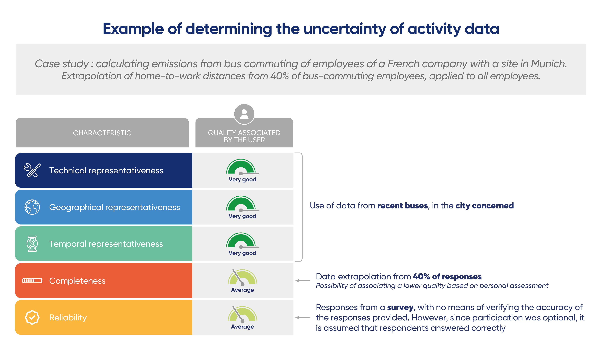
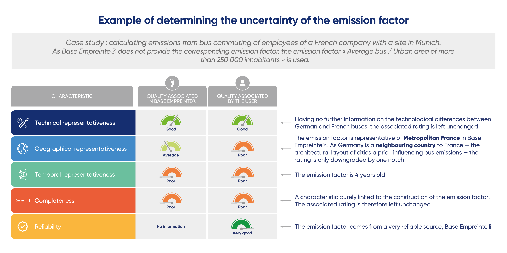

# Annex 3 - Example of Uncertainty Determination

> <mark style="background-color:blue;">⏳\[</mark>[<mark style="background-color:blue;">WIP</mark>](../../#structures-des-informations-specifiques)<mark style="background-color:blue;">] An annex providing guidance and practical examples for estimating uncertainty (qualitative and quantitative) will be drafted based on experiments. It will be made available shortly.</mark>

<figure><figcaption>
Figure Annex 3.1: Example of determining the uncertainty of activity data.
</figcaption></figure>

<figure><figcaption>
Figure Annex 3.2: Example of determining the uncertainty of the GHG emission factor
</figcaption></figure>
