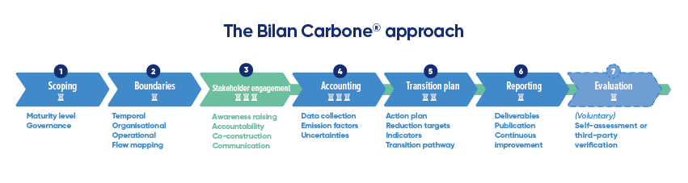
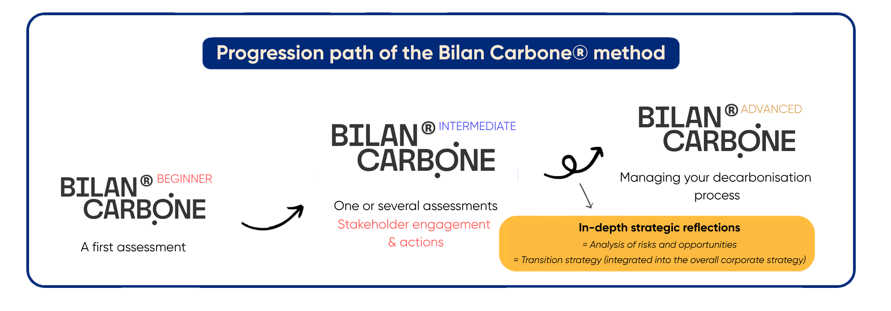
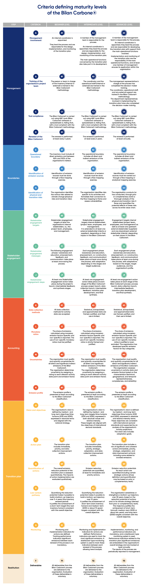
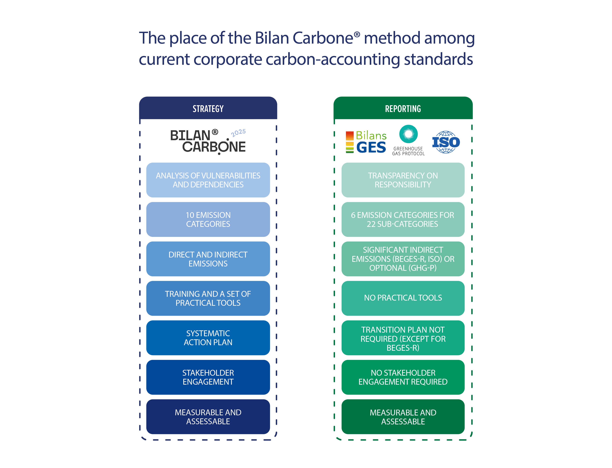

# 0.3 - Method summary

## Downloadable summary of the Bilan Carbone® Method



## Online summary of the Bilan Carbone® Method

:link: The full guide can be found here: [bilancarbone-methode.com](http://bilancarbone-methode.com/)

### **Introduction**

The **Bilan Carbone®,** developed by ADEME in 2004 and then by ABC since 2011, is a methodology for accounting and reducing greenhouse gas (GHG) emissions, developed to help organisations reduce their environmental impact. Its primary purpose is to provide a rigorous and comprehensive analysis of GHG emissions, both direct and indirect, enabling organisations to design and manage effective low-carbon transition plans.

This **new version** of the Bilan Carbone® introduces a modular methodology, a genuine excellence guide enabling the development of a continuous improvement approach and GHG emissions reporting. The methodology allows for deeper GHG accounting by conducting a strategic analysis of an organisation, and proposes best practices in terms of transition planning.

### **Objectives of the Bilan Carbone®**

The main objectives of the Bilan Carbone® are:

* **Stakeholder engagement**: engaging the organisation's stakeholders through awareness-raising, empowerment, co-construction and reporting of the transformations enabled by the transition plan.
* **Rigorous accounting of GHG emissions**: including all direct and indirect emission sources, covering the responsibility and dependency boundaries of the organisation.
* **Development of a transition plan**: building an ambitious and operational plan for the reduction of GHG emissions and climate change-related vulnerabilities, taking ownership of both the risks and the opportunities offered by the transition.

These objectives are broken down according to the organisation's maturity level in terms of carbon accounting, encouraging continuous improvement and progress with each iteration of the Bilan Carbone®.

### **Principles of the Bilan Carbone®**

The Bilan Carbone® is based on the following principles:

* Consistency: the approach is consistent with current challenges, that is, with national and international strategies to combat climate change (French National Low Carbon Strategy, Paris Agreement, etc.), and fosters the emergence of a low carbon society.
* Accuracy: the biases and uncertainties inherent to the approach are qualified, quantified and reduced as much as possible.
* Significance: the approach seeks to cover as many emissions as possible, and to act as a priority on all so-called significant emissions.
* Evaluation: the approach must lead to results that can be evaluated, in particular through the guide for the evaluation of a Bilan Carbone. This procedure is optional, but must be applicable to all the requirements of the approach.
* Transparency: the approach must be sufficiently transparent, and the results obtained must be published on the platform of the Observatory of Carbon Accounting in France (OCCF).
* Low-carbon strategy: the approach seeks to add a mitigation dimension to the organisation's strategy.
* Long-term vision: the approach contributes to defining a long-term low carbon transition vision for the organisation.
* Anticipation: the approach encourages anticipating upcoming changes.
* Pragmatism: the approach requires remaining pragmatic about the results obtained, which are not always those anticipated beforehand.

### **Steps of a Bilan Carbone®**

The Bilan Carbone® method is structured in seven steps:

<figure><figcaption></figcaption></figure>

1.  **Step 1 - Frame the approach**:

When launching a Bilan Carbone® approach, it is necessary to frame:\
    \- The organisation's maturity level in terms of carbon accounting and its position on the low carbon transition pathway. This involves drawing up an initial diagnosis: is the organisation carrying out its first or its umpteenth Bilan Carbone®? What are the internal and external expectations? What resources are available? Will this be a first or an umpteenth awareness-raising on planetary issues? The method is broken down into 3 main maturity levels in order to offer requirements adapted to the organisation and its objectives: Initial, Standard and Advanced.\
    \- Internal steering and governance make it possible to structure, coordinate and ensure the completion of the approach. The level of requirement for the steering of each step of the approach, in particular hierarchical involvement and training, may depend on the maturity level.
2.  **Step 2 - Define the boundaries**:

This method necessarily focuses on the emissions induced by an organisation. The organisation must define its organisational and temporal boundaries, and identify its emission sources in order to delimit its operational boundary. It identifies transition risks and opportunities. This makes it possible to delimit the study and prepare the accounting phase, while being certain to include all the organisation's direct and indirect GHG emissions. The level of requirement for identifying the boundaries may depend on the organisation's maturity level.
3.  **Step 3 - Plan Stakeholder engagement**:

Stakeholder engagement is a crucial part of the Bilan Carbone® approach, since it enables all of the organisation's stakeholders to be made aware and then to take action to carry out the Bilan Carbone® and launch the transition plan. Stakeholder engagement continues throughout the entire Bilan Carbone® approach, and must enable certain key messages to be conveyed in order to trigger a shift to action. The Bilan Carbone® method defines the expectations, i.e. the messages and content considered necessary to achieve a shift to action and a sufficient reduction in emissions. However, the means (formats, tools, etc.) of achieving these objectives remain at the discretion of the approach's coordinator. Stakeholder engagement requirements are adapted to the organisation and its resources, depending on its maturity level.
4.  **Step 4 - Account for emissions**:

The accounting step consists both in collecting all the required activity data and in converting it into tonnes of CO2 equivalent using emission factors. The aim is to draw up the organisation's GHG emissions profile, i.e. the breakdown of the organisation's quantified emissions across the different categories of the Bilan Carbone®. The uncertainties, inherent in the emission factors chosen and the data collected, must be quantified and displayed with full transparency on the emissions profile. The quality of the accounting (accuracy of activity data, emission factors, etc.) varies according to the organisation's maturity level and its resources.
5.  **Step 5 - Establish a transition plan**:

A transition plan must be defined following the accounting of emissions. This plan must include reduction targets, a series of detailed and quantified actions, and a credible pathway in relation to the actions envisaged and the targets set. Indicators enable the monitoring of the implementation and performance of these actions. The level of requirement of the transition plan should be adapted to the organisation and its resources according to its maturity level.
6.  **Step 6 - Summary and reporting of the approach**:

    The result of a Bilan Carbone® is the quantification of the organisation's GHG emissions, broken down by emission category within the considered boundaries, together with a coherent proposed transition plan and associated monitoring indicators. The expected Deliverables are framed and reported to the organisation for internal or external use, according to its maturity level. Various export formats for the Bilan Carbone® make it possible to meet regulatory requirements and align with other carbon accounting methods. The organisation prepares the next stage of its progress through continuous improvement. The anonymised emission profile must be submitted at minimum to the OCCF platform.
7.  **Step 7 - Evaluate the quality of the Bilan Carbone®**: Step 7 is optional and voluntary.

    The quality of the Bilan Carbone® approach can be evaluated by an independent evaluation team. The evaluation draws on the Deliverables produced during the approach, following a strict framework. Step 7 is optional and voluntary. Only a successful audit allows an organisation to claim an evaluated Bilan Carbone®.

### **Bilan Carbone® Maturity Scale**

There is a gradient of maturity levels, from the beginner organisation to the most experienced one. In order to adapt to this diversity, **the Bilan Carbone® method** **is divided into 3 main maturity levels (Initial, Standard and Advanced):**

*   **Initial level**: The typical profile is the organisation carrying out "**its first Bilan Carbone®**":

The organisation's goal is to mobilise certain key teams to carry out a first accounting of its GHG emissions, and to establish a simple transition plan associated with short-term objectives. One of the objectives of this first transition plan will be to renew the approach by aiming for a Standard level Bilan Carbone®. Hierarchical involvement and governance of the carbon topic are emerging. Generally speaking, this level is suited to an organisation that is just starting out or to a small structure with few resources, carrying out its first Bilan Carbone®, wishing to comply with the Regulatory GHG Assessment, or with the Diag Décarbon'action.
*   **Standard level**: The typical profile is the organisation carrying out "**a Bilan Carbone® and actions targeting all emissions**":

    The objective of a Standard-level Bilan Carbone® approach is to carry out a comprehensive accounting of its emissions, with a view to establishing a complete, quantified transition plan including medium-term objectives. All stakeholders will be mobilised, whether internal or external to the organisation. Management involvement and governance of the carbon topic are increasingly integrated. This is the Bilan Carbone® as it has historically been carried out, and it concerns the majority of organisations. A Standard-level Bilan Carbone® is typically an improved renewal of a previous Initial-level approach.
*   **Advanced level**: The typical profile is the organisation carrying out "**a Bilan Carbone® to steer its internal strategy**":

    An Advanced-level Bilan Carbone® is characterised by an in-depth accounting of the most significant emission categories. Between two renewals of the Bilan Carbone® (or during the approach itself), the organisation has acquired a transition risks and opportunities analysis to complement its Bilan Carbone® approach. Between two renewals of the Bilan Carbone® (or during the approach itself), the organisation has acquired a genuine low-carbon transition strategy (possibly via ACT Step-by-Step or other equivalent methods). The organisation can amend it and monitor its progress through the regular renewal of the Advanced-level Bilan Carbone®. The Bilan Carbone® serves as an internal management tool for the organisation's GHG emissions. Carbon indicators feed into the organisation's overall strategy. It is relevant at the Advanced level to implement analytical carbon accounting. The transition plan is quantified and sets a long-term objective for emissions reduction, or even business model transformation, credibilised by a decarbonation trajectory scheduled in the short, medium and long term. All stakeholders are mobilised. The Advanced-level Bilan Carbone® makes it possible to meet the majority of the requirements of CSRD ESRS E1. Management involvement and governance of the carbon topic are priorities for the organisation. This level concerns the most mature organisations on low-carbon transition issues, with dedicated internal resources. Evaluations of the Bilan Carbone® or of the organisation's strategy can confirm this maturity.

At the launch of the approach, the organisation must choose an appropriate maturity level and comply with the corresponding requirements. A maturity questionnaire enables a rapid estimate of an organisation's maturity level. It is not intended to be exhaustive, but provides an initial indication of the appropriate maturity level to aim for during the approach.

The organisation can directly target the level corresponding to its objectives, needs and maturity, without necessarily starting from the Initial level. The organisation must progress in terms of maturity with each iteration of the approach. This does not necessarily mean reaching a higher level.

<figure><figcaption></figcaption></figure>

### Summary of Bilan Carbon&#x65;**®** requirements

While the Bilan Carbone® provides a flexible methodology, the requirements for each level are strict. Each level is defined by specific criteria:

<figure><figcaption></figcaption></figure>

### **Reporting the Bilan Carbone®**

The conclusion of the approach and its reporting takes place in 2 or 3 stages:

1. An **internal reporting:** by the Bilan Carbone® coordinator, supported by the project team. It consists of all the Bilan Carbone® Deliverables (presented below). These deliverables are archived by the organisation itself.
2. A **reporting and publication** of results: on the one hand, to contribute to public knowledge in carbon accounting, the organisation's GHG profile is submitted anonymously to the Observatory of Carbon Accounting in France (OCCF) in order to improve knowledge on GHG emissions in the various sectors of activity. On the other hand, the organisation may publish its assessment (in whole or in part) on its website, in its external documentation and on social media.
3. A **reporting** possibly supported by a **voluntary evaluation**: Should the organisation wish to have its assessment evaluated by an independent evaluator, additional documents must be appended to the Bilan Carbone® Deliverables (presented below). The result of the evaluation will also appear on the Observatory of Carbon Accounting in France (OCCF).

The **Deliverables of a Bilan Carbone®** include:

* [x] Deliverables of step 1 - Framework:
  * A description of the organisation covered by the Bilan Carbone®: legal name, SIRET, SIREN, NAF code, number of FTEs;
  * A presentation of the approach's coordinator: name, position held (and trainee number and date of the Bilan Carbone® approach training where applicable). As well as, where applicable, the member of management sponsoring the approach: name, position held, trainee number, date of the training for Decision-makers attended.
  * A presentation of the project team carrying out the Bilan Carbone®: name, trainee number, date of the Bilan Carbone® approach training attended, organisation of affiliation (if external);
  * The organisation's maturity level;
* [x] Deliverables of step 2 - Boundaries:
  * The choice of the organisational boundary together with a justification (list of facilities and sites concerned);
  * The temporal boundary chosen;
  * The choice of the operational boundary (significance criterion where applicable) and its justification;
  * The organisation's flow mapping (quantified, where applicable) or the analytical mapping (where applicable);
  * The physical and transition risks linked to climate change; according to what is required at the maturity level (list of risks and opportunities, mapping of risks and opportunities, or analysis of risks and opportunities where applicable).
* [x] Deliverables of step 3 - Stakeholder engagement:
  * A summary of the various stakeholder engagement phases implemented: their targets, the messages conveyed, their format, the associated step of the approach;
* [x] Deliverables of step 4 - Accounting:
  * A summary of the data collected as well as a description of the data collection process followed (in a data collection matrix);
  * The documentation of the emission factors used, and of the spend-based emission factors (specific and non-specific) as well as their sources [(data collection matrix)](../4-comptabilisation/4.3-methode-de-selection-des-facteurs-demission.md#matrice-de-collecte-des-donnees);
  * The uncertainties associated with the organisation's GHG emissions profile;
  * The rate of use of spend-based emission factors associated with the organisation's GHG emissions profile;
  * The organisation's GHG emissions profile, listing emissions in tCO2e;
* [x] Deliverables of step 5 - Transition plan
  * The objectives of the transition plan;
  * The action plan through the complete set of action sheets;
  * The transition plan pathway;
  * The indicators (monitoring, implementation and performance), as well as the monitoring system used to track the transition plan, where applicable;

Important: the requirements for these deliverables may vary according to the approach's maturity level (Initial, Standard, Advanced). Details can be found in the full guide.

### **Evaluation of the Bilan Carbone®**

This is Step 7 (voluntary and optional) of the approach. One of the fundamental aspects of the Bilan Carbone® method is transparency throughout the entire calculation process, from the choice of boundaries to the means of communication with stakeholders.

The **evaluation** of a Bilan Carbone® thus guarantees the reliability of the results. It also makes it possible to identify blocking points and areas for improvement between two assessments carried out by an organisation. The evaluation is a voluntary approach with two objectives:

* To verify that the assessment complies with the requirements of the Bilan Carbone® method
* To confirm the maturity level of the organisation carrying out its assessment (this point can be useful for determining which complementary approach to the Bilan Carbone® can be initiated subsequently)

The evaluation of the Bilan Carbone® follows the process described in the Assessment Evaluation Guide: [bilancarbone-evaluation.com](https://www.bilancarbone-evaluation.com/).

### **Integration of the Bilan Carbone® into a Low-Carbon Transition approach**

The Bilan Carbone® approach and the reporting of its results can feed into other approaches.

The Bilan Carbone® method is **compatible** with the expectations of the GHG-P, BEGES-R, and ISO 14064-1. These standards address **complementary uses**, some **calculation procedures** differ and must be applied with caution.

The table below summarises the similarities and specificities between the Bilan Carbone® and the other current carbon accounting standards for an organisation:

<figure><figcaption></figcaption></figure>

The results of the Bilan Carbone® can feed into **regulatory reporting** processes (BEGES-R in France, CSRD in Europe).

Low carbon transition approaches help organisations move forward along their transition journey. Generally speaking, these approaches follow a structured process made up of several key stages, presented in a "**transition journey**". Each organisation **adapts** this journey to its own profile and maturity level, thereby ensuring its own transition towards a low carbon model. Full details can be found in the complete guide.

### Detailed and supplementary information

This summary is an overview of the Bilan Carbone® method. For more details, consult the full guide here: [bilancarbone-methode.com](http://bilancarbone-methode.com/).

The document is organised by step, sections are hierarchical, the search function enables quick access to information, and bibliographic cross-references smooth the user experience. This format allows both a more organised overall reading and a more efficient targeted reading, for example by referring to the **table of contents**.

### **Conclusion**

**The Bilan Carbone® is an essential method for organisations wishing to reduce their environmental impact and effectively steer their low-carbon transition. By following the steps (from stakeholder engagement to action) and the defined maturity criteria, organisations can make informed internal decisions, demonstrate their commitments externally, and** **progress along their low-carbon transition journey.**

***

_Do you have a question of understanding?_ [_Consult the FAQ_](../annexes/faq.md)_. The method is a living document and therefore subject to change (clarifications, additions): find the_ [_change log here_](../avant-propos/historique-et-suivi-des-modifications.md)_._
